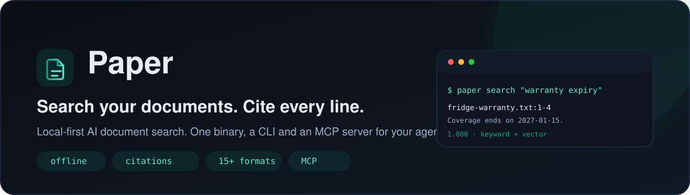

# Paper



[](https://github.com/arrowassassin/paperscope/actions/workflows/ci.yml)
[](https://crates.io/crates/paperscope)
[](https://crates.io/crates/paperscope)
[](#licence)
[](#install)

**Your documents, searchable — with receipts.** Paper is a local-first AI
document search engine: ask a question in plain language, get the answer *and*
the exact file, page and line it came from. One Rust binary. No account, no
API keys, no telemetry, no cloud.


> 15+ formats · 100+ languages · hybrid keyword + vector search · MCP server for
> Claude and other agents · runs fully offline.

## Install

```bash
# macOS / Linux (recommended)
curl --proto '=https' --tlsv1.2 -LsSf \
  https://github.com/arrowassassin/paperscope/releases/latest/download/paperscope-installer.sh | sh
```

```bash
brew install arrowassassin/tap/paper   # macOS / Linux, Homebrew
cargo install paperscope               # any platform with Rust 1.94+
```

**That is the whole setup.** The first time you run any `paper` command it:

1. registers a background indexer as a user service (launchd / systemd), so it
   survives reboots;
2. downloads the default embedding model (134 MB) in the background;
3. indexes `~/Documents`, `~/Downloads` and `~/Desktop`, then keeps them current
   with a five-minute incremental pass and a 3 AM full pass.

Keyword search works immediately; semantic results appear as soon as the model
lands. Prefer to drive it yourself? `PAPER_NO_AUTOSTART=1 paper index --root ~/Documents`,
or undo everything with `paper daemon-control uninstall`.

## Try it

```bash
$ paper search "when does the fridge warranty expire"
/Users/you/Documents/fridge-warranty.txt:1-4
  Samsung refrigerator warranty certificate … Coverage ends on 2027-01-15.
  1.000 · matched by keyword search
```

```bash
paper search "invoice from Acme in March" --after 2026-03-01 --ext pdf
paper answer "what did we agree about the deposit?"        # quotes, then answers
paper aggregate --field amount --op sum --filter kind=invoice
paper daemon-control status                                # what is indexed right now
```

Every hit carries `path` + `line_start` + `line_end`, so a citation always
resolves to the lines it quotes. `paper answer` is extractive: it shows the
source first, then a short answer, and never invents one.

## Why Paper

- **Citations, not vibes.** Hybrid FTS5 + `sqlite-vec` retrieval with rank
  fusion; low-confidence matches are dropped instead of answered.
- **Private by construction.** Embeddings and the index live in `~/Library` /
  `~/.local/share`; nothing leaves the machine. `PAPER_OFFLINE=1` blocks the
  network entirely.
- **Agent-ready.** Ships with an MCP server. Claude (or any MCP client) can
  search, read, index new folders and report index status — with path vetting so
  a prompt injection cannot reach `.ssh` or `.aws`.
- **Honest about its limits.** If the answer is not in your files, it says so
  instead of hallucinating. Exit code `1` means "not found", `3` means "model
  missing".

## Use it with Claude and other agents

```json
{
  "mcpServers": {
    "paper": { "command": "paper", "args": ["serve", "--mcp"] }
  }
}
```

Then just ask: *"Search my documents for the lease renewal date and cite the
page."* Install it as a Claude Code plugin from
[`paperscope-plugin.zip`](https://github.com/arrowassassin/paperscope/releases/latest/download/paperscope-plugin.zip),
or point `claude --plugin-dir ./paperscope-plugin` at a checkout.

MCP tools: `search_documents`, `read_source`, `list_sources`,
`answer_documents`, `index_documents`, `index_status`, `add_index_root`,
`remove_index_root`.

## What it reads

PDF (exact page), DOCX (paragraph ranges), Markdown, TXT, HTML, CSV, JSON, EPUB,
RTF, ODT, XLSX, PPTX, and images/PDF scans through optional OCR. English by
default; `multilingual-e5-small` adds 100 languages, including cross-lingual
search (ask in English, find the Japanese contract).

## Models

| Model | Size | Use |
|---|---|---|
| `bge-small-en-v1.5` | 134 MB | default English embeddings (auto-downloaded) |
| `multilingual-e5-small` | 487 MB | 100 languages |
| `bge-reranker-base` | 1.13 GB | optional precision boost |

```bash
paper models list
paper models install multilingual-e5-small
```

## Documentation

- [Architecture and retrieval design](docs/paper-architecture.md)
- [MCP setup per client](docs/CLAUDE_PLUGIN.md)
- [Website](https://kintsugi.tools/paperscope.html) · [Changelog](CHANGELOG.md)

## Build from source

```bash
cargo build --release          # single ~15 MB binary
cargo test                     # offline, no model downloads
./scripts/install-hooks.sh     # pre-commit: fmt + clippy
```

## Licence

MIT OR Apache-2.0. Licence texts in `LICENSE-MIT` and `LICENSE-APACHE`.
