# Paper


[](https://github.com/kintsugi-tools/paperscope/actions/workflows/ci.yml)
[](https://crates.io/crates/paperscope)
[](https://www.npmjs.com/package/paperscope)
[](https://crates.io/crates/paperscope)
[](https://m8ven.ai/mcp/kintsugi-tools-paperscope-mv88sq?s=readme)
[](https://glama.ai/mcp/servers/kintsugi-tools/paperscope)
[](#licence)
[](#install)

**Your documents, searchable, with receipts.** Paper is a local-first AI
document search engine: ask a question in plain language, get the answer *and*
the exact file, page and line it came from. One Rust binary. No account, no
API keys, no telemetry, no cloud.



> 15+ formats · 100+ languages · hybrid keyword + vector search · MCP server for
> Claude and other agents · runs fully offline.

Latest release: **[0.4.2](https://github.com/kintsugi-tools/paperscope/releases/tag/v0.4.2)**
· [changelog](CHANGELOG.md)

## Install

```bash
# macOS / Linux (recommended)
curl -fsSL https://kintsugi.tools/paper.sh | sh
```

```bash
brew install kintsugi-tools/tap/paper   # macOS / Linux, Homebrew
npm i -g paperscope                    # any OS with Node 14.18+; fetches the same binary
cargo install paperscope               # any platform with Rust 1.94+
```

**That is the whole setup.** The first time you run any `paper` command it:

1. registers a background indexer as a user service (launchd / systemd), so it
   survives reboots;
2. downloads the multilingual embedding model (488 MB, 100+ languages) in the background;
3. once it is in, indexes `~/Documents`, `~/Downloads` and `~/Desktop`, then keeps them current
   with a five-minute incremental pass and a 3 AM full pass.

Until the first index finishes, searches print (CLI) or report (MCP
`setup_in_progress`) that setup is still running. The reranker (488 MB) then
downloads in the background without delaying indexing, and ranking sharpens
when it lands. On a metered
connection or tight disk, `PAPER_NO_RERANKER=1` skips the 488 MB second model.
Prefer to drive it yourself? `PAPER_NO_AUTOSTART=1 paper index --root ~/Documents`,
or undo everything with `paper daemon-control uninstall`.

### Uninstall

```bash
paper uninstall            # removes the service, asks before deleting your data, then the binary
paper uninstall --keep-data   # leave the index, models and config in place
paper uninstall --dry-run     # show what would happen, change nothing
```

Add `--yes` to skip the question. Homebrew, cargo and npm installs print the
package-manager command to finish with (`brew uninstall paper`,
`cargo uninstall paperscope`, `npm uninstall -g paperscope`).

### Keeping it current

```bash
paper update --check   # is there a newer release?
paper update           # install it, using the same installer as a fresh install
```

If the version does not change after updating, two copies are installed and
another one comes first in `PATH`. `paper update` and `paper doctor` name the
copy that is shadowing you and how to fix it.

`paper update` is for the installer, Homebrew and cargo installs. If you came in
through npm, upgrade the way you installed: `npm i -g paperscope@latest`; through
Homebrew, `brew upgrade paper`.

### Updates

Paper updates itself by default, once a version has been approved by the maintainer (it never jumps to an unapproved release). It uses the same method you installed with: the installer script, `brew upgrade paper`, or `cargo install`; npm installs are told the command to run. Opt out with `PAPER_NO_AUTO_UPDATE=1` or `auto_update = false` in `config.toml`.

## Try it

```bash
$ paper search "when does the fridge warranty expire"
/Users/you/Documents/fridge-warranty.txt:1-4
  Samsung refrigerator warranty certificate … Coverage ends on 2027-01-15.
  1.000 · matched by keyword search
```

```bash
paper search "invoice from Acme in March" --after 2026-03-01 --ext pdf
paper answer "what did we agree about the deposit?"        # quotes, then answers
paper aggregate --field amount --op sum --filter kind=invoice
paper daemon-control status                                # what is indexed right now
```

Every hit carries `path` + `line_start` + `line_end`, so a citation always
resolves to the lines it quotes. `paper answer` is extractive: it shows the
source first, then a short answer, and never invents one.

## Why Paper

- **Citations, not vibes.** Hybrid FTS5 + `sqlite-vec` retrieval with rank
  fusion; low-confidence matches are dropped instead of answered.
- **Private by construction.** Embeddings and the index live in `~/Library` /
  `~/.local/share`; your documents never leave the machine. The background
  service downloads models and, once a day, a small signed settings file
  (default models, retired models); nothing is sent. `PAPER_OFFLINE=1` blocks
  the network entirely.
- **Agent-ready.** Ships with an MCP server. Claude (or any MCP client) can
  search, read, index new folders and report index status, with path vetting so
  a prompt injection cannot reach `.ssh` or `.aws`.
- **Honest about its limits.** If the answer is not in your files, it says so
  instead of hallucinating. Exit code `1` means "not found", `3` means "model
  missing".

## Use it with Claude and other agents

**Claude Code, one line each:**

```
/plugin marketplace add kintsugi-tools/paperscope
/plugin install paperscope@paperscope
```

The plugin adds a skill and starts `paper serve --mcp` from your `PATH`; install
the CLI first with the one-liner above. On claude.ai, upload
`paperscope-plugin.zip` from the release page instead.

**Any MCP client:**

```json
{
  "mcpServers": {
    "paper": { "command": "paper", "args": ["serve", "--mcp"] }
  }
}
```

Then just ask: *"Search my documents for the lease renewal date and cite the
page."* Install it as a Claude Code plugin from
[`paperscope-plugin.zip`](https://github.com/kintsugi-tools/paperscope/releases/latest/download/paperscope-plugin.zip),
or point `claude --plugin-dir ./paperscope-plugin` at a checkout.

MCP tools: `search_documents`, `read_source`, `list_sources`,
`answer_documents`, `index_documents`, `index_status`, `add_index_root`,
`remove_index_root`.

## What it reads

PDF (exact page), DOCX (paragraph ranges), Markdown, TXT, HTML, CSV, JSON, EPUB,
RTF, ODT, XLSX, PPTX, plus PNG, JPEG, TIFF, WebP, BMP and GIF images.

**Scans are searchable.** OCR runs automatically on pages with no text layer,
pulling the page bitmap straight out of the PDF, and on standalone images. Text
found this way is cited as `page 12 (OCR)`, so you always know it came from a
picture, not a text layer. Works in 100+ languages (`multilingual-e5-small`, the default embedder), including cross-lingual search (ask in English, find the Japanese
contract).

## Models

| Model | Size | Use |
|---|---|---|
| `multilingual-e5-small` | 488 MB | default embeddings, 100+ languages (auto-downloaded) |
| `bge-small-en-v1.5` | 134 MB | optional English-only embeddings |
| `mmarco-mminilmv2-l12-h384` | 488 MB | reranks top hits, ~14 languages (auto-downloaded; `PAPER_NO_RERANKER=1` to skip) |
| `bge-reranker-v2-m3` | 2.3 GB | optional best-quality reranker, 100+ languages, much slower |
| `bge-reranker-base` | 1.13 GB | previous default reranker (English, Chinese); retired |
| PP-OCRv4 det + rec | 16 MB | reads scans and images (auto-downloaded; `--no-ocr` to skip) |

```bash
paper models list
paper models install multilingual-e5-small
```

## Documentation

- [Implementation status](docs/implementation-status.md)
- [MCP setup per client](docs/CLAUDE_PLUGIN.md)
- [Packaging](docs/PACKAGING.md) · [Cutting a release](docs/RELEASE.md)
- [npm](https://www.npmjs.com/package/paperscope) · [crates.io](https://crates.io/crates/paperscope)
- [Website](https://kintsugi.tools/paperscope.html) · [Changelog](CHANGELOG.md)

## Build from source

```bash
cargo build --release          # single ~30 MB binary, OCR and embeddings included
cargo build --release --no-default-features   # keyword-only, no Candle/tract
cargo test                     # offline, no model downloads
./scripts/install-hooks.sh     # pre-commit: fmt + clippy
```

## Licence

MIT OR Apache-2.0. Licence texts in `docs/LICENSE-MIT` and
`docs/LICENSE-APACHE` — the root `LICENSE-*` files belong to unrelated work in
this repository and are not part of the crate.
